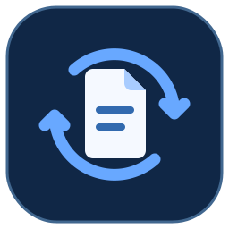
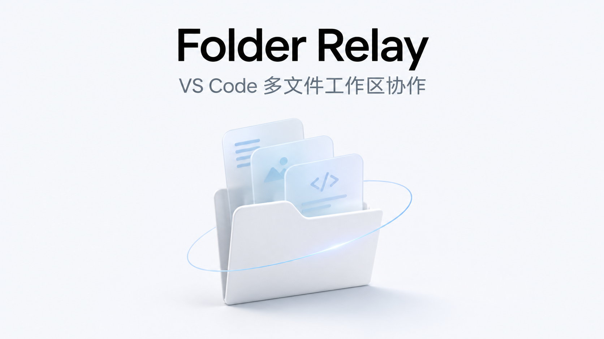

# Folder Relay

**VS Code 多文件工作区协作**

Folder Relay 让小组成员在各自的 VS Code 中维护同一个项目目录。Markdown、Python、CSV、LaTeX、图片以及 Word、Excel、PowerPoint 文件都能放在一起，保存后的文件版本会按项目内的相对路径同步。项目在每台电脑上都有一份本地副本，断网时也能继续编辑，恢复连接后再同步。符合条件的非重叠文本改动可以自动合并，Office 文件和图片按整份同步。



项目原名 LaTeX Sync Workspace。新版沿用已有扩展 ID、`LSW:` 命令和工作区连接配置，可直接从旧版升级。

## 下载和开始使用

| 文件 | 谁需要 |
| --- | --- |
| [Folder Relay Office 版 VSIX](https://github.com/WinsDuan/folder-relay/releases/download/v0.3.2/latex-sync-workspace-0.3.2-office.vsix) | 发起人和组员都安装。在 VS Code 扩展面板选择 **从 VSIX 安装**。 |
| [Windows x64 云隧道程序](https://github.com/WinsDuan/folder-relay/releases/download/v0.3.2/cloudflared-windows-amd64.exe) | 需要跨网共享时，由 Windows x64 发起人运行。其他平台按 [Cloudflare 官方下载说明](https://developers.cloudflare.com/tunnel/downloads/)选择对应版本。 |
| [Windows 双端连接操作手册 PDF](https://github.com/WinsDuan/folder-relay/releases/download/v0.3.2/Folder-Relay-Windows-Guide.pdf) | 查阅服务器启动、令牌、局域网、云隧道和组员连接步骤。 |
| [v0.3.2 发布页](https://github.com/WinsDuan/folder-relay/releases/tag/v0.3.2) | 下载源码压缩包、[SHA-256 校验表](https://github.com/WinsDuan/folder-relay/releases/download/v0.3.2/SHA256SUMS.txt)和 [cloudflared 第三方声明](https://github.com/WinsDuan/folder-relay/releases/download/v0.3.2/cloudflared-NOTICE.txt)。 |

**发起人**先启动服务，在 VS Code 打开要共享的项目目录并加入工作区，等文件上传后，把地址、工作区 ID 和令牌私发给组员。**组员**在 VS Code 安装扩展、打开空文件夹，再用同一工作区信息加入。两端操作见 [使用教程](docs/quickstart.md)。

| 你想做什么 | 从哪里开始 |
| --- | --- |
| 第一次发起共享，或收到安装包后加入 | [Folder Relay 使用教程](docs/quickstart.md) |
| 了解主要功能、适用场景和三人分工示例 | [项目说明](docs/overview.md) |
| 安装扩展、启动本机服务、试用两个窗口 | [使用指南](docs/project.md) |
| 让另外两台电脑加入同一项目 | [三台电脑怎么连接](docs/project.md#三台电脑怎么连接) |
| 给小组配置一个常在线的服务地址 | [云主机部署步骤](infra/deploy/README.md) |
| **跨城/跨网远程协作，要求连接稳定** | [远程架构](docs/remote-architecture.md) → [远程部署](docs/deployment-remote.md) → [协议 v1](docs/remote-protocol.md) |
| 上传源码、分发安装包、发布到 VS Code 扩展商店 | [发布指南](docs/publishing.md) |

## 本机试用

准备 Node.js 24 或更新版本，以及 VS Code 1.96 或更新版本。打开仓库根目录，在 PowerShell 中运行：

```powershell
npm ci
npm run package:vsix
```

从 VS Code 的扩展面板选择 **从 VSIX 安装**，选择 `apps/vscode-extension` 下刚生成的 `.vsix` 文件。按[使用指南](docs/project.md#启动本机服务)启动服务，然后用 VS Code 打开要分享的项目目录，点击状态栏的 **Folder Relay 连接工作区**。另开一个 VS Code 窗口，打开新建的空文件夹，用相同的连接信息加入。可以用几个 Markdown、Python、CSV 文件试同步，也可以复制 [LaTeX 示例](examples/phase1)体验写作和本地编译。

## 协作编辑 Office 文件

把 Word、Excel 或 PowerPoint 文件放到已连接的共享文件夹里。在 VS Code 的资源管理器中右键文件，选择 **Folder Relay: 在办公应用中打开**。系统会用已为该格式设置的默认桌面应用打开文件。在办公应用中保存到原路径后，Folder Relay 会将新版本同步给其他成员。

Office 文档按整份文件同步，单文件上限为 16 MiB。同一份文档可以轮流编辑，保存并关闭后交给下一位成员。两端各自保存了不同版本时，可以通过 **LSW: Review Project Conflict** 查看保留的副本。

关闭文档后仍显示同步中时，可以检查同目录是否有旧版本同步过来的 `~$` 临时锁文件。确认成员都已关闭该文档，再清理对应的残留锁文件。

## 仓库内容

- `apps/vscode-extension` 包含 VS Code 扩展、连接窗口和文件同步逻辑。
- `apps/collab-server` 包含协作服务和 SQLite 持久化。
- `examples` 包含可用于试用的 LaTeX 文件。`tests` 包含协议测试和 VS Code 测试。
- [架构记录](docs/architecture.md)、[技术选型记录](docs/phase-0.md)和[远程编译可行性记录](docs/github-actions.md)保留早期设计背景。现有的旧版单文件工作流见[单文件模式](docs/windows.md)。

## 构建与验证

```powershell
npm test
npm run test:project
npm run test:vscode
npm run package:vsix
```

VS Code 测试使用隔离的用户和扩展目录。若 VS Code 安装在自定义路径，可以设置 `LSW_VSCODE_EXECUTABLE` 指定可执行文件。查看[验证说明](docs/verification.md)了解各项测试的范围。

项目代码采用 [MIT 许可证](LICENSE)。扩展安装包附带打包依赖的许可证。
