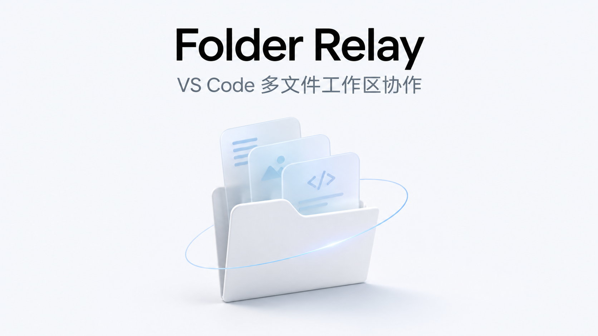

# Folder Relay 产品说明

**VS Code 多文件工作区协作**

Folder Relay 是一套面向小组的项目文件协作工具。每位成员在 VS Code 打开自己的本地文件夹，连接同一个协作服务。有人保存 Markdown 说明、Python 脚本、CSV 数据或插图，其他人可以在自己的文件夹收到更新。断网时仍可编辑已有文件，恢复连接后再同步。

## 为什么按项目目录协作

一份分析项目往往同时有脚本、结果表、图表和说明。只交换最后一张图或一份 PDF，接手的人很难知道它对应哪个版本的数据和脚本。把文件放进同一项目目录后，组员可以各管一部分，保存后按原来的目录结构同步。项目仍保存在本地，编辑器、命令行和辅助工具可以直接打开这些文件。

## 它能做什么

| 功能 | 在项目协作中的作用 |
| --- | --- |
| 同步项目文件夹 | Markdown、Python、CSV、LaTeX、参考文献和图片等符合规则的文件按项目内的相对路径同步。每位成员可把项目放在自己习惯的位置。 |
| 从空目录加入 | 发起人先上传已有工程，组员在新建的空目录连接，扩展把共享文件下载到对应位置。 |
| 在 VS Code 里填写连接信息 | 打开 **连接共享工作区** 窗口，输入服务器地址、工作区 ID 和访问令牌。以后打开同一个文件夹，扩展会尝试恢复连接。 |
| 同步辅助工具写入的文件 | Codex、Claude 或脚本写入的项目文件，和编辑器保存的文件一样可以参与同步。也可以用脚本生成插图，再让其他成员收到保存后的文件。 |
| 断网编辑和恢复同步 | 已下载的文件保存在本机。断网期间保存的改动留在本地，服务可达后扩展会尝试同步。 |
| 保护并发改动 | 受支持的文本文件如果有共同的基线，且双方改动不重叠，可尝试自动合并。图片等二进制文件按整份同步，并发改动时保留冲突版本。 |
| 用本机工具处理项目 | 成员可在本地运行 Python 脚本、检查数据或编译 LaTeX。共享服务负责同步文件。 |

项目执行环境由各台电脑管理。以 LaTeX 为例，安装 XeLaTeX、latexmk 或 LaTeX Workshop 后，成员可以用本地副本编译，断网时也能检查已经下载的工程。交稿前可约定统一的编译命令、字体和依赖，减少 PDF 在不同电脑上的差异。

## 适合哪些场景

- **数据分析和实验复现。** 一位成员维护 `analysis.py`，另一位检查 `results.csv`，第三位在 `README.md` 记录实验步骤并引用结果图。每个人都能从自己的目录重新运行分析。
- **数学建模与 LaTeX 论文。** 建模、代码和写作成员分别维护章节、脚本和结果图。收到最新公式、引用和图片后，写作成员可在本地重新编译。
- **课程报告与技术文档。** 一人准备目录和素材，其余成员从空目录加入，各自负责一份文档。汇总时可在完整工程中检查引用和排版。
- **用 AI 辅助编辑项目。** 让本机辅助工具修改指定脚本或整理文档，核对结果后保存。Folder Relay 同步写入磁盘的文件，AI 工具的联网和访问权限由工具自身管理。
- **异地协作和临时断网。** 小组通过一个可达的服务地址协作。成员临时掉线时，可以继续编辑已经下载的项目文件，重新连上后再同步。

## 三台电脑怎么一起工作

| 角色 | 首次加入 | 日常使用 |
| --- | --- | --- |
| A，发起人 | 用 VS Code 打开已有项目，连接一个空的共享工作区，等初始文件上传完成。 | 在自己的文件夹编辑、保存和运行项目。 |
| B，组员 | 打开新建的空文件夹，填写同一协作服务的地址、工作区 ID 和令牌，等待下载。 | 打开原来的文件夹，接收更新并保存自己的改动。 |
| C，组员 | 使用自己的空文件夹，按与 B 相同的方式加入。 | 在自己的副本中编辑和检查项目。 |

A 是上传初始工程的人。协作服务负责接收和保存共享版本，可以部署在 A 的电脑上，也可以部署在另一台常在线的主机上。只要服务仍在运行，A 关闭 VS Code 后，B 和 C 也能继续协作。如果承载服务的主机关机，三个人还能编辑本地已有文件，等服务恢复后再交换改动。

在同一台电脑用两个 VS Code 窗口试用时，可以用本机回环地址，例如 `ws://127.0.0.1:1234`。三台电脑正式连接时，请使用服务管理员提供的地址。`127.0.0.1` 总是指向当前这台电脑，跨电脑可使用带证书的固定地址或已建立的 SSH 私有转发。参见[三台电脑怎么连接](project.md#三台电脑怎么连接)和[部署指南](deployment.md)。

## 同步、合并与冲突

共享工作区同步的是**写到磁盘的文件版本**。连接后，扩展会尝试自动保存 VS Code 中可安全保存的编辑，并检查本地文件与服务端版本。服务端以项目内的路径区分文件。比如 A 的 `D:\report\scripts\analysis.py` 和 B 的 `C:\work\scripts\analysis.py`，只要各自选对项目根目录，都会对应共享工作区里的 `scripts/analysis.py`。

如果两人从同一版 `notes.md` 出发，一个改开头的实验条件，另一个补充末尾的观察结果，Folder Relay 可以尝试合并两处改动。自动合并需要共同的基线，适用于不超过 1 MiB 的受支持 UTF-8 文本，例如 `.md`、`.py`、`.csv` 和 `.tex`。如果双方改了同一段，或者分别替换了同一路径下的图片，扩展会保留冲突版本供比较，其他文件仍可同步。此时点击 **Folder Relay 工作区有冲突**，比较本机和共享版本，整理并保存目标文件，再运行 **LSW: Publish Resolved Project File**。参见[日常编辑与冲突处理](project.md#日常编辑编译与离线)。

协作时可以按脚本、数据、文档分工，或者让每人负责一份章节文件。交接时等状态栏显示 **Folder Relay 工作区已同步**，再让下一位修改同一段。删除仍在同步范围内的文件也可能传播到共享工作区，正式项目宜保留独立备份。

## 三人小组如何合成一份数模报告

1. **A 写模型。** 在 `main.tex` 里组织章节与参考文献，发起共享。随后在 `sections/model.tex` 里写模型假设、符号说明和求解公式。
2. **B 跑实验。** 用脚本计算结果，将图保存为 `figures/result.png`，并在 `sections/results.tex` 写结果分析及图片引用。B 可以在本机先编译，检查图片尺寸和图注。
3. **C 校对与排版。** 在 `references.bib` 补充引用条目，等模型章节、结果章节和插图同步到本地后，按小组约定的命令编译 `main.tex`，检查公式编号、文献引用和页面布局。最终提交的 PDF 由 C 选定版本后生成。

## 一个上手例子

1. 在本机启动协作服务。安装扩展后，在第一个 VS Code 窗口打开一份试验工程，可以放几份 Markdown、Python 和 CSV 文件，也可以复制 [LaTeX 示例目录](../examples/phase1)。
2. 点击状态栏的 **Folder Relay 连接工作区**。填写服务地址、工作区 ID 和令牌，连接后等状态栏显示 **Folder Relay 工作区已同步**。
3. 再开一个 VS Code 窗口，打开新建的空文件夹。填写相同的连接信息，确认项目文件已经下载。
4. 在第二个窗口修改一份文件，保存后到第一个窗口确认更新。使用 LaTeX 示例时，可再用本机工具链编译，检查 PDF。

服务启动命令、令牌的复用方式和扩展安装步骤见[共享工作区使用指南](project.md)。

## 当前版本的使用边界

- **更适合互相信任的小组。** 当前一个服务实例对应一个工作区。持有该工作区令牌的成员可以修改和删除共享文件。需要按成员分配只读、写入或撤销权限的团队，应把权限要求纳入选型。
- **共享项目所需的文件。** 单文件上限 16 MiB，工作区上限 128 MiB。同步规则会排除 `.git`、`.vscode`、`node_modules` 等目录，以及常见 LaTeX 临时文件和与 `.tex` 同名的生成 PDF。大数据集和大附件可另行存放。
- **按保存后的文件版本同步。** 项目的编辑、运行和编译在各成员电脑上进行。同步与冲突处理方式见[同步架构](architecture.md)。
- **先用小样例验证团队网络。** 0.2.2 已在同一台 Windows 电脑的两个独立 VS Code 窗口验证连接、下载、双向同步、断线恢复及本地编译。跨机器连通性、延迟与多人负载需按实际部署复测。详见[构建与验证](verification.md)。

扩展当前可通过构建出的 VSIX 安装。公开分发的方式及 Visual Studio Marketplace 的发布步骤见[发布指南](publishing.md)。
