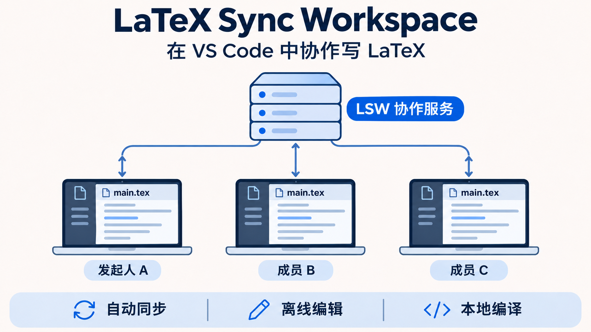

# LaTeX Sync Workspace 产品说明

LaTeX Sync Workspace（LSW）是一套面向小组的 LaTeX 项目协作工具。每位成员在 VS Code 打开自己的本地项目文件夹，连接同一个 LSW 服务。成员保存正文、参考文献或插图后，其他成员可以在各自的文件夹收到更新，继续写作或编译。已有文件在断网期间仍可编辑，恢复连接后再交换改动。

## 为什么做 LSW

一次数模竞赛里，负责建模的人在写公式，负责程序的人在更新结果图，负责排版的人在调整目录和参考文献。如果三个人靠压缩包交换工程，很容易遇到一份文件里有新图，另一份文件里才有最新正文。收到别人发来的 PDF，也没法直接改其中引用的 `.tex`、`.bib` 和图片。

LSW 把同步放进大家已经在用的 VS Code。组员可以分工维护同一项目的不同文件，继续用熟悉的 LaTeX 工具链和辅助编辑工具。交接时打开原来的项目，就能沿着同一份目录结构继续工作。

## 它能做什么

| 功能 | 在实际写作中的作用 |
| --- | --- |
| 同步项目文件夹 | `.tex`、`.bib`、插图和其他符合规则的文件按项目内的相对路径同步。每位成员可把项目放在自己习惯的位置。 |
| 从空目录加入 | 发起人先上传已有工程，组员在新建的空目录连接，扩展把共享文件下载到对应位置。 |
| 在 VS Code 里填写连接信息 | 打开 **连接共享工作区** 窗口，输入服务器地址、工作区 ID 和访问令牌。以后打开同一个文件夹，扩展会尝试恢复连接。 |
| 同步辅助工具写入的文件 | Codex、Claude 或脚本写入的项目文件，和编辑器保存的文件一样可以参与同步。也可以用脚本生成插图，再让其他成员收到保存后的文件。 |
| 断网编辑和恢复同步 | 已下载的文件保存在本机。断网期间保存的改动留在本地，服务可达后扩展会尝试同步。 |
| 保护并发改动 | 同一文件的不同位置若有共同的文本基线，可尝试合并。改到同一位置或同时替换同一图片时，扩展会保留冲突版本，供成员比较和处理。 |
| 在各自电脑上编译 | 任何成员都可以用本机的 XeLaTeX、latexmk 或 LaTeX Workshop 编译自己的项目副本。 |

同步和编译分开，是因为团队共同维护的是源码和素材，编译用到的 TeX 发行版、字体和工具配置由各台电脑管理。共享服务负责传递和保存项目版本，成员可以选择合适的本机工具检查排版，断网后也能编译已下载的工程。准备交稿时，团队可约定统一的编译命令、字体和依赖，以减少不同电脑生成的 PDF 之间的差异。

## 适合哪些场景

- **数学建模与竞赛论文。** 建模、代码和写作成员分别维护章节与结果图。当天调整模型后，写作成员可以用同步过来的公式和结果重新编译。
- **课程报告与小组作业。** 一位同学准备模板和参考文献库，其余同学从空目录加入，各自负责一节。汇总时大家可以在完整工程中检查图表引用和排版。
- **科研论文与技术文档。** 合作者用不同电脑维护正文、附录和 `.bib`，在本地核对引用和版式。文件较多时，可以按章节拆分，减少同时修改同一段落。
- **用 AI 辅助修改 LaTeX。** 让本机的辅助工具按约定修改指定章节或整理表格，自己检查公式、数据和引用，再编译。LSW 处理的是保存后的文件变更，AI 服务的联网和使用权限仍由各自工具决定。
- **异地写作和临时断网。** 小组通过一个可达的服务地址协作。成员外出或临时掉线时，可以继续写已经下载的章节，重新连上后再同步。

## 三台电脑怎么一起工作

| 角色 | 首次加入 | 日常使用 |
| --- | --- | --- |
| A，发起人 | 用 VS Code 打开已有 LaTeX 项目，连接一个空的共享工作区，等初始工程上传完成。 | 在自己的文件夹编辑、保存和编译。 |
| B，组员 | 打开新建的空文件夹，填写同一协作服务的地址、工作区 ID 和令牌，等待下载。 | 打开原来的文件夹，接收更新并保存自己的改动。 |
| C，组员 | 使用自己的空文件夹，按与 B 相同的方式加入。 | 在自己的副本中编辑和编译。 |

A 是上传初始工程的人。LSW 服务负责接收和保存共享版本，可以部署在 A 的电脑上，也可以部署在另一台常在线的主机上。只要服务仍在运行，A 关闭 VS Code 后，B 和 C 也能继续协作。如果承载服务的主机关机，三个人还能编辑本地已有文件，等服务恢复后再交换改动。

在同一台电脑用两个 VS Code 窗口试用时，可以用本机回环地址，例如 `ws://127.0.0.1:1234`。三台电脑正式连接时，请使用服务管理员提供的地址。`127.0.0.1` 总是指向当前这台电脑，跨电脑可使用带证书的固定地址或已建立的 SSH 私有转发。参见[三台电脑怎么连接](project.md#三台电脑怎么连接)和[部署指南](deployment.md)。

## 同步、合并与冲突

共享工作区同步的是**写到磁盘的文件版本**。连接后，扩展会尝试自动保存 VS Code 中可安全保存的编辑，并检查本地文件与服务端版本。服务端以项目内的路径区分文件。比如 A 的 `D:\report\sections\model.tex` 和 B 的 `C:\work\sections\model.tex`，只要各自选对项目根目录，都会对应共享工作区里的 `sections/model.tex`。

如果两人从同一版 `model.tex` 出发，一个改开头的模型假设，另一个改末尾的求解说明，LSW 可以尝试合并两处文本修改。如果两人同时改写同一个公式，或者分别替换了同一路径下的图片，扩展会保留能找到的版本供比较，其他文件仍可同步。此时点击 **工作区有冲突**，比较本机和共享版本，整理并保存目标文件，再运行 **LSW: Publish Resolved Project File**。参见[日常编辑与冲突处理](project.md#日常编辑编译与离线)。

多人写作时，最省事的分工是每人负责一份章节文件。交接时看一下状态栏，等 **工作区已同步** 后，再让下一位修改同一段。删除仍在同步范围内的文件也可能传播到共享工作区，正式项目宜保留独立备份。

## 三人小组如何合成一份数模报告

1. **A 写模型。** 在 `main.tex` 里组织章节与参考文献，发起共享。随后在 `sections/model.tex` 里写模型假设、符号说明和求解公式。
2. **B 跑实验。** 用脚本计算结果，将图保存为 `figures/result.png`，并在 `sections/results.tex` 写结果分析及图片引用。B 可以在本机先编译，检查图片尺寸和图注。
3. **C 校对与排版。** 在 `references.bib` 补充引用条目，等模型章节、结果章节和插图同步到本地后，按小组约定的命令编译 `main.tex`，检查公式编号、文献引用和页面布局。最终提交的 PDF 由 C 选定版本后生成。

## 一个上手例子

1. 在本机启动 LSW 服务。安装扩展后，用第一个 VS Code 窗口打开一份试验工程，可将 [示例目录](../examples/phase1) 复制出来使用。
2. 点击状态栏的 **LSW 连接工作区**。填写服务地址、工作区 ID 和令牌，连接后等状态栏显示 **工作区已同步**。
3. 再开一个 VS Code 窗口，打开新建的空文件夹。填写相同的连接信息，确认 `main.tex` 和其他项目文件已经下载。
4. 在第二个窗口修改一行，保存后到第一个窗口确认更新。最后用本机的 LaTeX 工具链编译，检查 PDF。

服务启动命令、令牌的复用方式和扩展安装步骤见[共享工作区使用指南](project.md)。

## 当前版本的使用边界

- **更适合互相信任的小组。** 当前一个服务实例对应一个工作区。持有该工作区令牌的成员可以修改和删除共享文件。需要按成员分配只读、写入或撤销权限的团队，应把权限要求纳入选型。
- **共享正文、文献和项目素材。** 单文件上限 16 MiB，工作区上限 128 MiB。同步规则会排除常见 LaTeX 临时文件、与 `.tex` 同名的生成 PDF，以及 `.git`、`.vscode` 等本机目录。只共享项目所需的目录，大数据集和大附件可另行存放。
- **本地编译，按文件版本同步。** 如果需要在浏览器里写作、由服务器统一编译，或查看其他成员逐字输入和光标，这些需求超出了当前共享工作区模式。扩展和服务的边界见[同步架构](architecture.md)。
- **先用小样例验证团队网络。** 0.2.2 已在同一台 Windows 电脑的两个独立 VS Code 窗口验证连接、下载、双向同步、断线恢复及本地编译。跨机器连通性、延迟与多人负载需按实际部署复测。详见[构建与验证](verification.md)。

扩展当前可通过构建出的 VSIX 安装。公开分发的方式及 Visual Studio Marketplace 的发布步骤见[发布指南](publishing.md)。
